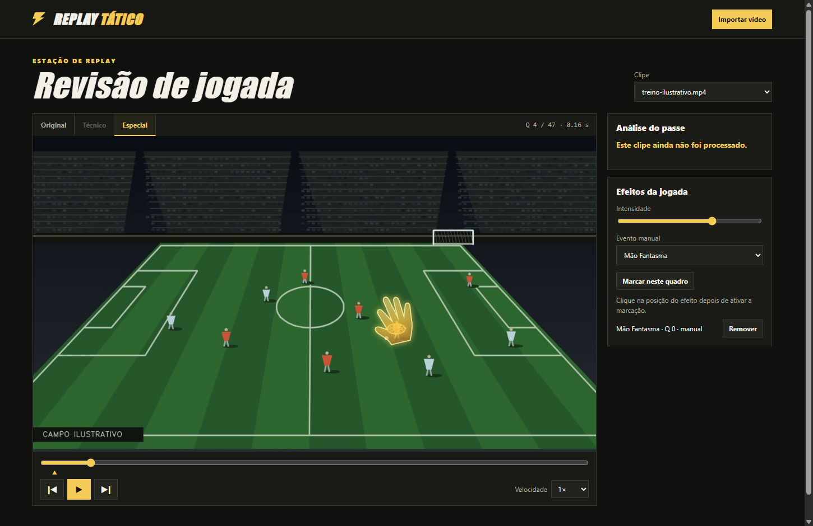
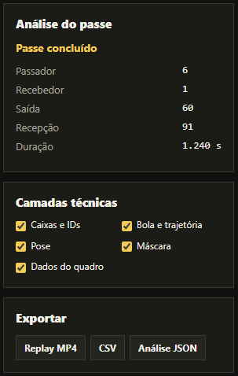

# Replay Tático

[Versão em português](README.md)

Replay Tático reconstructs a football pass from match footage and produces an annotated replay for technical review. It was built for the Computer Graphics course at IFSULDEMINAS, Machado campus.

- **Original** plays the source and supports frame-by-frame inspection and independent annotation.
- **Technical** displays player IDs, ball trajectory, pose, segmentation, and depth evidence.
- **Special** adds Canvas effects to pass events and user-positioned cinematic markers.



## Online demo

The static demo replays the observations from both locally processed clips on an original schematic pitch. It shares the studio controls and keeps technical overlays, visual effects, and schematic maps of the measured player depths. Importing videos, running inference, viewing source footage, and inspecting dense depth maps are features of the local studio. [Vercel setup](demo/README.md)

## Install and run

Use Git and 64-bit Python 3.14. In Windows PowerShell:

```powershell
git clone https://github.com/Lucas04zx/ReplayTatico.git
Set-Location ReplayTatico
python -m venv .venv
$rtPython = ".\.venv\Scripts\python.exe"
& $rtPython -m pip install torch==2.10.0 torchvision==0.25.0 --index-url https://download.pytorch.org/whl/cu128
& $rtPython -m pip install -r requirements.txt
& $rtPython -m pip check
& $rtPython -m replay_tatico preparar-modelos
& $rtPython -m replay_tatico baixar
& $rtPython -m unittest discover -s tests -v
```

For CPU execution, use `https://download.pytorch.org/whl/cpu` for the PyTorch install. The CUDA setup requires an NVIDIA driver that supports CUDA 12.8. The application runs offline once the models and source videos are available.

```powershell
& $rtPython -m replay_tatico analisar data/raw/0bfacc_0.mp4 --inicio 55 --fim 160 --saida outputs/ajuste
& $rtPython -m replay_tatico estudio
```

Open the studio in your browser and select `ajuste`. The app also imports local videos for inspection. To process a new clip, run `analisar` with the source path and inclusive zero-based frame indices. Select a new output directory for each analysis. [Local studio](http://127.0.0.1:8765/?clipe=run-ajuste)

## Architecture

OpenCV decodes the source and verifies its frame timing. YOLO26n detects people and ByteTrack maintains their IDs within a clip. A specialist model from Roboflow detects the ball. The pipeline estimates pose in player crops and associates detections by box overlap. Pass inference combines foot proximity, separation, leg movement, track continuity, and a change in ball motion or sustained proximity at contact.

Ultralytics 8.4.219 runs the `yolo26n.pt`, `yolo26n-pose.pt`, `yolo26n-seg.pt`, and `yolo26n-depth.pt` weights, plus the Roboflow `football-ball-detection.pt` detector. Inference runs sequentially on PyTorch and caches the observations. Flask serves the studio, and Canvas draws the special effects. [ByteTrack settings](configs/bytetrack.yaml)

## Verified results

| Clip | Evidence | Result |
| --- | --- | --- |
| Tuning, `0bfacc_0.mp4`, frames 55–160 | Automatic trajectory and player roles | Player 6 → 1, frames 60–91, **1.24 s** |
| Evaluation, `2e57b9_0.mp4`, frames 402–471 | Manual reference recorded before inference | Frames 411–456, **1.80 s** |
| Evaluation, same clip | Frozen automatic pipeline | **Inconclusive**, with no ball detection at frames 409–410 immediately before the marked release |



To reproduce the evaluation, extract `data/annotations/avaliacao.json` from the academic release ZIP into the same path in your clone. Run the commands below after downloading the weights and videos.

```powershell
& $rtPython -m replay_tatico avaliar
& $rtPython -m replay_tatico evidencias-avaliacao
& $rtPython -m replay_tatico empacotar
```

The evaluation preserves the inconclusive result in its CSV and replay. The secondary visual replay labels its event markers as manual. The three frame/depth pairs use those reference frames, and depth is summarized by the median of the positive finite values inside each player's mask. [Academic release](https://github.com/Lucas04zx/ReplayTatico/releases/tag/tp2-1.0) · [Report in Portuguese](docs/RELATORIO.md)

## Limitations and licensing

Occlusion, a small ball in wide shots, camera motion, and track switches can obscure the decisive frames of a pass. Monocular depth supports an in-frame comparison of estimated proximity. This experiment has no camera-specific calibration or ground-truth distances. Shot, save, goal, and interception effects use manual markers.

Replay Tático code is licensed under the [GNU AGPL-3.0](LICENSE). Dependencies, model weights, and football footage retain their own terms. [Third-party licenses and assets](docs/LICENCAS.md)
