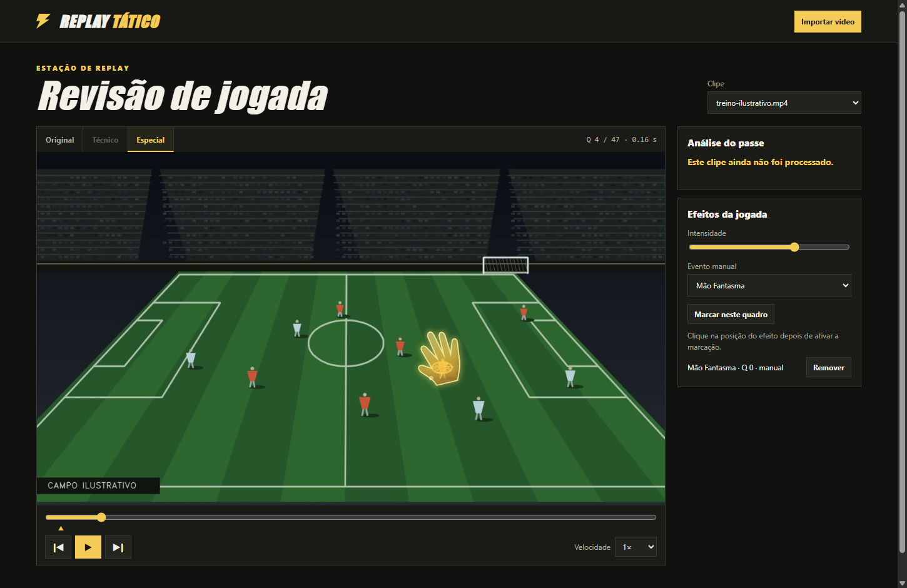
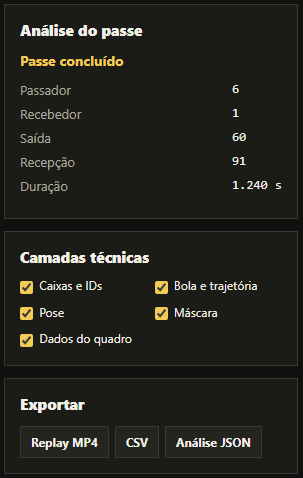

# Replay Tático

[English version](README.en.md)

Replay anotado de futebol para estudar a trajetória de um passe, o gesto do passador e a posição dos jogadores em relação à câmera. Trabalho Prático 2 de Computação Gráfica do IFSULDEMINAS, Campus Machado.

**Professor** Renan · **Entrega e apresentação** 9 de dezembro de 2026

## O sistema

- **Original** para inspeção quadro a quadro e marcação independente.
- **Técnico** para revisar IDs, trajetória, pose, segmentação, profundidade e evidências.
- **Especial** para visualizar efeitos nos mesmos eventos de passe e criar marcadores cinematográficos manuais.

Python e OpenCV leem os quadros originais. Ultralytics, PyTorch e ByteTrack geram as observações. A análise do passe combina essas observações com o movimento da perna e a continuidade temporal. Flask e Canvas exibem o replay no navegador local. As inferências são executadas sequencialmente e podem ser reutilizadas do cache.



## Demonstração online

A demonstração estática reproduz as observações dos dois lances processados localmente. Os modos Esquema, Técnico e Especial compartilham os controles do estúdio. Os mapas esquemáticos mostram a posição e as medianas dos jogadores calculadas pelo modelo, com a origem manual identificada na avaliação. A importação, a inferência de novos clipes, os vídeos originais e os mapas densos estão disponíveis no estúdio local. [Configuração da Vercel](demo/README.md)

## Instalação

Pré-requisitos: Git, Python 3.14 de 64 bits e espaço para dependências e vídeos. No PowerShell:

```powershell
git clone https://github.com/Lucas04zx/ReplayTatico.git
Set-Location ReplayTatico
python -m venv .venv
$rtPython = ".\.venv\Scripts\python.exe"
& $rtPython -m pip install torch==2.10.0 torchvision==0.25.0 --index-url https://download.pytorch.org/whl/cu128
& $rtPython -m pip install -r requirements.txt
& $rtPython -m pip check
```

Para executar em CPU, troque o índice `cu128` por `https://download.pytorch.org/whl/cpu`. Para usar CUDA, instale um driver NVIDIA compatível com CUDA 12.8. O tempo de inferência varia com o equipamento.

## Preparação dos insumos

```powershell
& $rtPython -m replay_tatico preparar-modelos
& $rtPython -m replay_tatico baixar
& $rtPython -m replay_tatico verificar data/raw/0bfacc_0.mp4
& $rtPython -m replay_tatico verificar data/raw/2e57b9_0.mp4
& $rtPython -m replay_tatico inspecionar data/raw/0bfacc_0.mp4
& $rtPython -m unittest discover -s tests -v
```

Use A/D ou as setas para retroceder ou avançar um quadro, J/L para saltar um segundo e Espaço para alternar pausa e reprodução. Os índices começam em zero e referem-se ao vídeo de origem. O comando `verificar` decodifica todos os quadros e verifica se a cadência é constante a partir dos timestamps.

## Modelos e rastreador

| Tarefa | Peso |
| --- | --- |
| Detecção e rastreamento de pessoas | `yolo26n.pt` |
| Detecção de bola | `football-ball-detection.pt` do Roboflow |
| Pose | `yolo26n-pose.pt` |
| Segmentação | `yolo26n-seg.pt` |
| Profundidade monocular | `yolo26n-depth.pt` |

O ambiente usa Ultralytics 8.4.219 e OpenCV 4.13.0. O comando `preparar-modelos` obtém e verifica o SHA-256 da [release oficial do YOLO26n](https://github.com/ultralytics/assets/releases/tag/v8.4.0) e do [detector oficial do exemplo Roboflow](https://github.com/roboflow/sports/blob/main/examples/soccer/setup.sh). O [ByteTrack](configs/bytetrack.yaml) recebe quadros consecutivos com `persist=True` e reinicia a cada trecho.

## Reproduzir o ajuste

```powershell
& $rtPython -m replay_tatico analisar data/raw/0bfacc_0.mp4 --inicio 55 --fim 160 --saida outputs/ajuste
& $rtPython -m replay_tatico estudio
```

Em [127.0.0.1:8765](http://127.0.0.1:8765/?clipe=run-ajuste), selecione `ajuste` para alternar original, técnico e especial. A importação abre vídeos para inspeção. Para processar outro vídeo, use `analisar` com o caminho e os índices inclusivos do lance. Escolha uma pasta de saída nova em cada execução. Depois do primeiro download dos pesos e vídeos, a análise, os replays e o estúdio funcionam localmente.

### Exemplo real

O ajuste no `0bfacc_0.mp4` associou o passe ao jogador **6 → 1**. A saída foi estimada no quadro **60**, a recepção no **91** e a duração em **1,24 s**. A análise registrou 16 quadros sem detecção de bola em 106, todos após a recepção estimada. Os três mapas usaram máscaras de ambos os jogadores. O [relatório](docs/RELATORIO.md) apresenta os números e as dificuldades observadas na calibração.



### Arquivos gerados

| Artefato | Conteúdo |
| --- | --- |
| `replay.mp4` | H.264 com índices de origem, caixas, IDs, pose, máscara e trajetória |
| `resultado.csv` | Resultado no formato do enunciado |
| `analise.json` | Parâmetros, eventos, FPS, perdas, versão dos modelos e motivo de eventual inconclusão |
| `quadros.json` e `mascaras.npz` | Dados consumidos pelo estúdio e pelas camadas visuais |
| `evidencias/` | RGB, profundidade colorida, tabela de medianas, três momentos da pose e par caixa/máscara |

Campos ausentes ficam vazios no CSV. O estado `INCONCLUSIVO` indica evidência insuficiente para afirmar a jogada. Os valores de profundidade servem para comparar superfícies dentro do mesmo quadro.

## Avaliação independente

Use o clipe `Avaliação · anotação independente` no [estúdio](http://127.0.0.1:8765/?clipe=avaliacao). O vídeo é `2e57b9_0.mp4`, quadros **402–471**, inclusive. O grupo deve registrar a saída e a recepção e clicar no tronco dos dois jogadores nos quadros orientados pela ferramenta. Depois de salvar a referência:

```powershell
& $rtPython -m replay_tatico avaliar
& $rtPython -m replay_tatico evidencias-avaliacao
```

O comando `avaliar` confere o SHA-256 de vídeo, configuração, rastreador e pesos. A inferência utiliza o vídeo e os parâmetros congelados. Depois, a comparação gera `outputs/avaliacao/avaliacao.json`, com identidade e erros quando o passe automático puder ser identificado. A execução de referência registrou **411 → 456, 1,80 s** manualmente. A inferência retornou **inconclusivo** após perder a bola nos quadros 409 e 410, imediatamente antes da saída marcada.

`evidencias-avaliacao` usa os quadros e os IDs associados à referência para gerar um replay com eventos rotulados como manuais e três pares RGB/profundidade em `outputs/avaliacao/referencia-visual`. O replay e o CSV automáticos originais preservam o resultado inconclusivo.

O [status](docs/STATUS.md) acompanha a implementação e os testes. O [checklist](docs/REQUIREMENTS_CHECKLIST.md) registra os requisitos do trabalho.

## Vídeos e entrega

Os vídeos usados localmente vêm do [Roboflow Soccer AI](https://github.com/roboflow/sports/tree/main/examples/soccer). Preserve o arquivo de origem e sua numeração de quadros. A referência independente do segundo lance será criada pelo grupo antes da inferência automática.

O Git guarda o código e a documentação. O pacote `ReplayTatico-resultados-e-referencia.zip` da [release do TP2](https://github.com/Lucas04zx/ReplayTatico/releases/tag/tp2-1.0) inclui os resultados e a referência usada na comparação. Extraia `data/annotations/avaliacao.json` desse ZIP na mesma pasta relativa do clone para reproduzir a comparação. Os replays e quadros do vídeo são gerados localmente a partir das fontes do professor.

Para organizar os arquivos de apresentação depois de gerar análise e evidências:

```powershell
& $rtPython -m replay_tatico empacotar
```

O comando salva os dois ZIPs em `outputs/entrega`. Use o pacote local para a apresentação offline com os vídeos baixados. Consulte as [fontes dos vídeos](docs/VIDEOS.md) e a [licença do Ultralytics](https://www.ultralytics.com/license).

## Limitações e licença

Câmera em movimento, bola pequena, oclusão e trocas de ID podem comprometer a identificação. Os mapas representam estimativas monoculares para comparar os jogadores dentro de um quadro. O modo Especial usa eventos de passe do pipeline e marcadores manuais para gols, chutes, defesas e interceptações.

O código do Replay Tático é disponibilizado sob a [GNU AGPL-3.0](LICENSE). Dependências, pesos e vídeos mantêm seus próprios termos. [Licenças e origem dos materiais](docs/LICENCAS.md)
